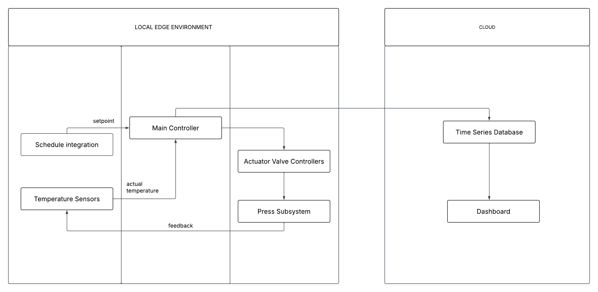

# Scheduling and Valve Control to Cut Steam Peaks and Idle Waste in Solid Tyre Curing Presses

[](LICENSE)
[](https://www.python.org/)
[](https://github.com/coin-or/Cbc)
[](https://www.advantech.com/)
[](docs/poster.pdf)

> **Aim:** A retrofit smart layer on top of existing plant machinery to cut boiler peak steam spikes and eliminate idle steam waste in solid tyre curing presses without slowing production.

Developed by **Yasiru Bandara** | Supervised by **Dr. Sulochana Sooriyaarachchi**  
Department of Computer Science & Engineering, University of Moratuwa, in collaboration with **ThermoTune Pte. Ltd.**

---

## 1. The Two Problems

Sri Lanka manufactures nearly 25% of global solid tyres. Curing (vulcanization) holds green rubber inside heavy steel moulds at target curing temperatures (**~130 °C**) for long cycles (~6–7 hours) using pressurized steam. Existing presses in local plants rely strictly on manual on/off steam valves without automated controllers or digital sensors. Replacing these presses is cost-prohibitive, making a low-cost retrofit the only practical solution.

In typical plant operations, steam is wasted through two distinct mechanisms:

1. **Demand Spikes (Problem 1):** At the beginning of shifts, multiple presses are switched on simultaneously. Their simultaneous heating ramp-ups cause severe steam draw spikes, depressing central boiler header pressure and forcing the boiler to burn excessive auxiliary fuel.
2. **Idle Steam Waste (Problem 2):** During operator meal breaks, shift handovers, inter-batch tyre changeovers, or mechanical halts, supply valves remain cracked open or unattended. Steam bleeds continuously into idle, empty moulds for hours without producing tyres.

---

## 2. System Architecture

To eliminate both problems without replacing heavy mechanical infrastructure, the system implements a two-tier retrofit architecture:


*Fig. 2: System design architecture. An edge controller executes the global MILP scheduler and per-press valve controllers, dispatching valve commands over RS-485 Modbus RTU while receiving mould temperature feedback.*

- **Tier 1: Plant-Wide MILP Scheduler (`scheduler/`)**  
  Solves a discrete-time Mixed Integer Linear Program using PuLP and COIN-OR CBC (15-second budget) to compute staggered start offsets across all presses, flattening the aggregate boiler peak steam demand.
- **Tier 2: Per-Press Smart Valve Controller (`controller.py`, `pid_controller.py`)**  
  An autonomous local controller managing three critical tasks:
  1. *Dynamic Preheat Lead Time:* Numerically reverse-integrates the mould cooling curve to fire preheating at the exact minute required to reach 130 °C right as the tyre is loaded.
  2. *Schedule-Driven Idle Decision:* Automatically evaluates inter-job gaps—closing the valve completely (0%) on long breaks or holding standby on short changeovers.
  3. *Closed-Loop PID Temperature Regulation:* PID with a 26.25% steady-state feedforward bias and anti-windup clamping to hold cure temperature and recover from cold tyre insertion shock.

---

## 3. Results Table

All figures below are measured experimentally from the **Digital Twin simulation** (130 °C target curing temperature) and the **Physical Bench Prototype** (85 °C water test rig).

> *Note: Bench results reflect single physical experimental runs; baseline energy consumption is estimated from physical heating/cooling rates.*

| Test & Metric | Ordinary / Baseline | Smart Controller | Result / Improvement | Reproduction Command |
| :--- | :--- | :--- | :--- | :--- |
| **Peak Steam Draw Reduction**<br>*(Twin: 8–20 presses, 15 s solve limit)* | Uncoordinated simultaneous start spikes | Staggered start offsets (5-min discretization) | **57.85% to 62.65% lower peak**<br>(8 press: 58.4–60.2%, 20 press: 62.3–62.7%) | `python scheduler/benchmark.py` |
| **Idle Gap Steam Consumption**<br>*(Twin: 2.5 h inter-job gap)* | **1.62 kg**<br>(15% cracked open valve) | **1.29 kg**<br>(autonomous shutoff + dynamic reheat) | **20.4% less steam**<br>(0.33 kg net steam saved) | `python run_valve_evaluation.py` |
| **Full 10.5 h Shift Steam**<br>*(Twin: 2 curing jobs + 2.5 h gap)* | **6.75 kg** | **6.60 kg** | **2.2% net shift steam saved**<br>(0.15 kg net steam saved) | `python run_valve_evaluation.py` |
| **Preheat Lead Time Accuracy**<br>*(Twin: mould temp at 08:00 start)* | **141.91 °C**<br>(naive fixed 60 min timer; +11.91 °C overshoot) | **130.04 °C**<br>(dynamic reverse integration, 20.6 min lead) | **0.04 °C error**<br>(zero wait time, no preheat overheating) | `python run_valve_evaluation.py` |
| **Cure Temperature Regulation**<br>*(Twin: 6.5 h cure hold + tyre shock)* | Uncontrolled drift<br>(±8 to 15 °C) | PID with feedforward bias<br>(holds within **±1.4 to 2.3 °C**) | **Recovers in 21 min** from -6.8 °C cold tyre drop | `python run_valve_evaluation.py` |
| **Bench Idle Gap Energy**<br>*(Bench: 4-min gap on 85 °C water rig)* | Continuous holding / cracked valve | Schedule-based shutoff<br>(heater off 130 s, 84.00 °C at Job 2 start) | **52% less idle gap energy**<br>(single run; smart started 0.8 °C warmer) | `python bench/plot_poster_charts.py` |
| **Bench Control Overshoot**<br>*(Bench: 50 W heater step response)* | **1.5 °C**<br>(conventional on/off relay) | **0.5 to 0.7 °C**<br>(time-proportioned PID) | **>50% lower overshoot** | `python bench/plot_poster_charts.py` |
| **Bench Preheat Timing**<br>*(Bench: cold start to 85 °C)* | Fixed 300 s lead<br>(left water 27.00 °C short) | Dynamic 1354 s lead<br>(calculated from 1.03 °C/min heating rate) | **Arrived within 0.75 °C** on scheduled minute | `python bench/plot_poster_charts.py` |

---

## 4. Hardware Bill of Materials

The physical prototype and plant retrofit design utilize industrial off-the-shelf components:

| Hardware Component | Role in Architecture | Communication / Signal |
| :--- | :--- | :--- |
| **Raspberry Pi 5 / reTerminal CM4** | Central Edge Controller running MILP, Twin & Dashboard | USB / RS-485 / Ethernet |
| **Advantech ADAM-4115** | Industrial 8-Channel RTD / Thermocouple Input Module | RS-485 Modbus RTU (Slave ID 1) |
| **Advantech ADAM-4024** | Industrial 4-Channel Analog Output Module (Transmits 4–20 mA) | RS-485 Modbus RTU (Slave ID 2) |
| **I/P Transducer** | Converts 4–20 mA electrical signal to 3–15 psi pneumatic control pressure | 4–20 mA input, pneumatic output |
| **Pneumatic Steam Control Valve** | Regulates high-pressure saturated steam flow into mould | 3–15 psi pneumatic actuation |
| **PT1000 Temperature Probe** | Measures steel mould temperature in real time | 2-wire / 3-wire RTD to ADAM-4115 |
| **ESP32 Dev Module** | Benchtop controller & hardware-in-the-loop (HIL) physics simulator | USB Serial / GPIO / OneWire |
| **DS18B20 Digital Sensor** | Benchtop water temperature measurement probe | OneWire Bus (GPIO 4) |
| **50 W Heating Element & Relay** | Benchtop surrogate heat source simulating steam heat transfer | Active-low relay (GPIO 5) |

---

## 5. How to Run

### 5.1 Installation & Setup
```bash
# Clone the repository
git clone https://github.com/yasiru2003/steam-aware-valve-control.git
cd steam-aware-valve-control

# Create and activate virtual environment
python3 -m venv .venv
source .venv/bin/activate  # On Windows: .venv\Scripts\activate

# Install dependencies
pip install -r requirements.txt
```

### 5.2 Run the MILP Scheduler Benchmark
Executes the peak steam minimization scheduler across 8 to 20 presses (homogeneous and heterogeneous cases):
```bash
python scheduler/benchmark.py --limit 15 --step 5
```
*Outputs benchmark summary to console and records solve times and peak reduction percentages in `scheduler/benchmark_results.csv`.*

### 5.3 Run the Digital Twin Evaluation
Executes the three physical verification proof tests (Idle Gap test, Preheat Lead Time test, and PID Tracking test):
```bash
python run_valve_evaluation.py
```
*Generates verification CSV logs in `evaluation_results/` and prints exact measured metrics.*

### 5.4 Launch the Interactive Dashboard (HMI)
Starts the Streamlit telemetry and digital twin visualization dashboard:
```bash
streamlit run app.py
```
*Open `http://localhost:8501` to view live thermal trajectories, schedule state changes, and energy metrics.*

### 5.5 Reproduce Poster Charts
Generates high-resolution figures matching **Fig. 5a** (peak steam cut bar chart) and **Fig. 5b** (bench idle gap trajectory) from the showcase poster:
```bash
python bench/plot_poster_charts.py
```
*Generates `bench/fig5a_peak_steam_reduction.png` and `bench/fig5b_bench_idle_gap.png`.*

### 5.6 Test Hardware Modbus Bridge
Validates RS-485 communication with ADAM-4115 and ADAM-4024 (runs in simulation mock mode if serial adapter is absent):
```bash
python hardware/adam_modbus_bridge.py
```

---

## 6. Repository Layout

```text
steam-aware-valve-control/
├── README.md                      # Project documentation and showcase guide
├── LICENSE                        # MIT License
├── requirements.txt               # Python package dependencies
├── .gitignore                     # Repository exclusion rules
│
├── app.py                         # Streamlit interactive operations dashboard
├── controller.py                  # Core Supervisory Controller finite state machine
├── pid_controller.py              # Actuator PID controller with feedforward & anti-windup
├── press_model.py                 # Lumped thermal capacitance physics model
├── parameters.py                  # Physical constants (mass, heat capacity, latent heat)
├── disturbance.py                 # Factory floor disturbance engine (cold tyre shock)
├── schedule_fetcher.py            # CSV production schedule parser
├── simulation.py                  # Single-press simulation loop
├── multi_simulation.py            # Multi-press simulation loop
├── run_valve_evaluation.py        # Reproduction script for twin proof tests
│
├── scheduler/                     # MILP Steam Demand Peak-Flattening Scheduler
│   ├── milp_scheduler.py          # PuLP optimization formulation & CBC integration
│   ├── profiles.py                # Tyre specifications and steam draw curves
│   ├── benchmark.py               # Benchmark harness across 8 to 20 presses
│   ├── benchmark_results.csv      # Empirical peak reduction logs (57.85% to 62.65%)
│   ├── MODEL_DOCUMENTATION.md     # Mathematical formulation and complexity notes
│   └── results/                   # Generated shift schedules and timeseries
│
├── firmware/                      # Physical Bench Prototype Firmware
│   └── esp32_bench/
│       ├── platformio.ini         # PlatformIO project configuration
│       └── src/
│           └── main.cpp           # ESP32 firmware (DS18B20 + Relay + PID + Idle Logic)
│
├── hardware/                      # Industrial Hardware Bridges
│   ├── adam_modbus_bridge.py      # ADAM-4115 (PT1000) & ADAM-4024 (4-20mA) Modbus RTU bridge
│   └── esp32_serial_bridge.py     # USB serial hardware-in-the-loop bridge
│
├── bench/                         # Physical Bench Test Evidence & Charts
│   ├── logs/
│   │   ├── smart_bench_test.csv   # Real bench run logs (smart idle shutoff + reheat)
│   │   └── naive_bench_test.csv   # Real bench run logs (15% cracked valve baseline)
│   ├── plot_poster_charts.py      # Chart generation script for Fig. 5a & Fig. 5b
│   ├── fig5a_peak_steam_reduction.png
│   └── fig5b_bench_idle_gap.png
│
├── evaluation_results/            # Digital twin verification CSV logs
│   ├── idle_gap_test_baseline.csv
│   ├── idle_gap_test_controller.csv
│   ├── preheat_lead_time_test.csv
│   └── pid_tracking_test.csv
│
├── schedules/
│   └── schedule.csv               # Industrial shift schedule
│
└── docs/
    ├── poster.pdf                 # Embedded Systems Showcase Poster (Batch 23)
    └── architecture_block_diagram.png # Fig. 2 system architecture schematic
```

---

## 7. Limitations & Future Work

1. **Anti-Windup Refinement:** In the current digital twin implementation, a residual steady-state bias of approximately +1.35 °C was observed after severe cold tyre shock recovery. Implementing back-calculation anti-windup (rather than conditional clamping) is planned to eliminate this offset.
2. **Idle-Gap Decision Hysteresis:** On the physical bench prototype, sensor measurement quantization and noise near the decision boundary caused mode oscillation between idle-shutoff and hold. Introducing a hysteresis threshold margin is required for factory floor deployment.
3. **Steam Header Feedback Coupling:** The current scheduler operates open-loop with respect to boiler pressure. Future iterations will couple live header pressure measurements from vortex flowmeters into the edge controllers.
4. **Plant Pilot Deployment:** The immediate next milestone is piloting the ADAM Modbus RTU hardware bridge and PT1000 sensor on an active solid tyre press in a production facility.

---

## 8. License & Acknowledgments

This project is licensed under the [MIT License](LICENSE).

- **Academic Supervisor:** Dr. Sulochana Sooriyaarachchi, Department of Computer Science & Engineering, University of Moratuwa.
- **Industry Partner:** ThermoTune Pte. Ltd., Singapore, for domain expertise, guidance, and project sponsorship.
- **Factory Host:** Sincere gratitude to our industrial partner for hosting the site visit, providing access to solid tyre curing machinery, and supporting sustainable manufacturing innovation.
